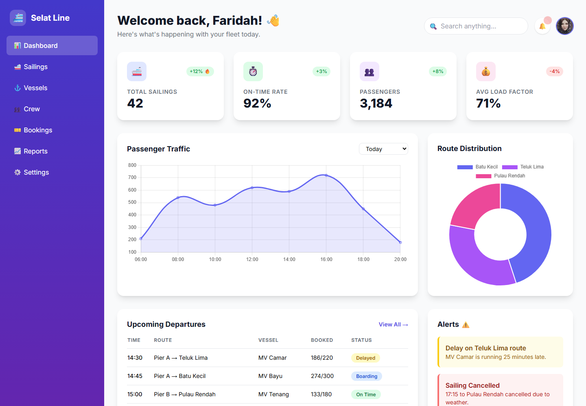
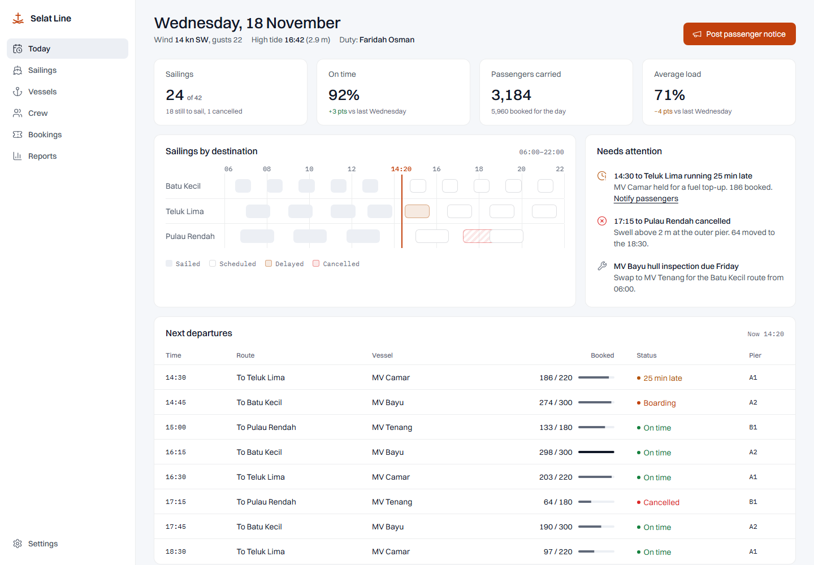
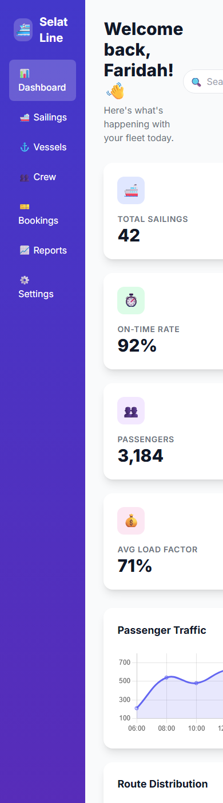
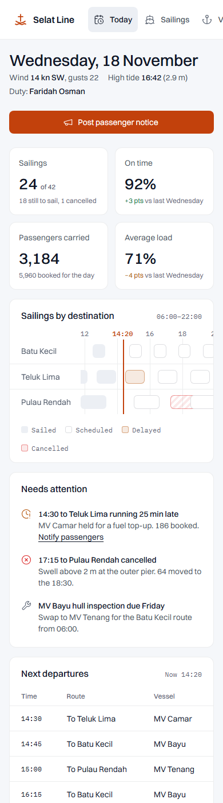

# ui-ux-tips

A Claude Code skill that makes AI-built interfaces look designed instead of generated.

One entry point, `SKILL.md`, routes each task to the right rules: 27 short topic guides for everyday UI work, and four full procedures for removing the AI look, polishing, motion, and award-level craft. Ask for it by name in any project; it reads only the guides the task needs.

<table>
  <tr>
    <th width="50%">Without the skill</th>
    <th width="50%">With the skill</th>
  </tr>
  <tr>
    <td></td>
    <td></td>
  </tr>
</table>

Same brief, same data, same model. [Details of the comparison](#the-comparison) below.

## Install

Global, for every project:

```bash
npx skills add hzqdev30/ui-ux-tips -g
```

One project only (run inside the project folder):

```bash
npx skills add hzqdev30/ui-ux-tips
```

Or clone it by hand:

```bash
git clone https://github.com/hzqdev30/ui-ux-tips ~/.claude/skills/ui-ux-tips
```

## Use

Start a new session and name the skill in your request:

```text
use ui-ux-tips to review this login page
use ui-ux-tips and build the settings screen
this dashboard looks AI-made, unslop it with ui-ux-tips
use ui-ux-tips to add motion to the checkout drawer
```

The skill picks the guides that match, applies them, and finishes full-screen work with a review checklist. To force a specific guide, name it: "use the buttons guide from ui-ux-tips".

## What's inside

| Folder | What it holds |
|---|---|
| `principles/` | UX laws, a principles cheat sheet (Disney's 12, Fitts, Hick, Doherty, Postel and more), visual hierarchy, spacing and grids |
| `foundations/` | Color, dark mode, typography, font picks by vibe, a font download map, 22 background treatments, icons |
| `components/` | Buttons, forms, login and password UX, selection controls, feedback states and dialogs, navigation, cards, pricing |
| `screens-and-flows/` | Dashboards, settings, onboarding, mobile and touch |
| `cross-cutting/` | UX writing, the pre-share design review checklist |
| `procedures/` | Four full workflows: **unslop** (remove the AI look), **polish** (fine to exceptional, frame-by-frame motion), **ux-animation** (the 20 principles of UX and animation), **unreasonable-craft** (award-level, opt-in only) |
| `examples/` | A login before/after and the dashboard comparison below |

Rules from different sources sometimes disagree (a guide says "show a spinner", a procedure says "only after 300ms"). `SKILL.md` ends with a **Resolved conflicts** list that settles each one, so the skill never applies two contradicting rules.

### Fonts

`foundations/font-picks.md` groups typefaces by feel and lists the ones that now read as AI-made (Geist, Space Grotesk, Instrument Sans, JetBrains Mono and others). `foundations/font-sources.md` maps 25 free fonts, all cleared for commercial use, to their license, official page, download link and npm package, and `font-sources.css` loads all of them for trying out.

## The comparison

Both dashboards answer the same brief: *a duty manager's dashboard for a small island ferry operator, plain HTML and CSS*. They share the same sailings, routes and vessels.

- **Without the skill** ([source](examples/dashboard-comparison/without-skill/index.html)): built from the brief alone, with no guide loaded.
- **With the skill** ([source](examples/dashboard-comparison/with-skill/index.html)): built after loading the dashboard, hierarchy, spacing, color, font and unslop guides, then reviewed against them and fixed in three rounds at desktop and phone width.

Both were written by the same model (Claude). The baseline is one sample, not a benchmark, so treat this as an illustration of what the rules change.

### What the review found in the baseline

Each line is a rule from the skill that the baseline breaks, with the file that holds the rule.

| Baseline | Rule | With the skill |
|---|---|---|
| Purple-to-indigo gradient sidebar | No hue-to-hue gradients; one accent from the product's world (`unslop` signs) | Neutral sidebar; one buoy-orange accent for the main action and the "now" line |
| Emoji as nav and stat icons (⛴️ 📊 💰 🔥) | Emoji become one line-icon set (`unslop` pass 3) | One line-icon set at one size and stroke |
| "Welcome back, Faridah! 👋" + a subtitle restating it | No greeting headlines, no exclamation marks; cut subtitles that add nothing | The date as the title, with wind, tide and the duty manager beside it |
| UPPERCASE TRACKED labels | Sentence case; hierarchy from size and colour (`Resolved conflicts`) | Sentence case, 4 type sizes |
| "+12% 🔥" with nothing to compare to | A change says what it compares to | "+3 pts vs last Wednesday" |
| Passenger line chart + route doughnut, equal weight | One main chart showing the real job; second block is a list (`dashboards-and-data`) | A day timeline of every sailing by destination, with a list of what needs attention beside it |
| `hover:scale-105` on cards, pinging bell dot | No scale on wide surfaces; no looping motion on things that are not live | Color change on hover only; nothing loops |
| Main action is a gradient 🚀 button at the bottom of the alerts card | One primary action, in reach, never decorated | "Post passenger notice" top-right, one solid fill |
| `shadow-lg` on every card | Soft, consistent depth; follow the project's design source | One depth cue per surface |
| Sidebar and header do not adapt on a phone | Recompose for small screens, 44px touch targets (`mobile-ui-and-touch`) | Sidebar becomes a scrolling top bar; the timeline opens at the current time with lane names pinned |

The skilled version also adds things the baseline has no rule for: a linked hover between the timeline and the table (brushing and linking), sailings already done fading back, and tabular figures so numbers do not shift.

<table>
  <tr>
    <th width="50%">Without the skill, 390px wide</th>
    <th width="50%">With the skill, 390px wide</th>
  </tr>
  <tr>
    <td></td>
    <td></td>
  </tr>
</table>

To try the fonts on the skilled version, open `examples/dashboard-comparison/with-skill/fonts.html`.

## Credits and licensing

The `procedures/` folder is a copy of four skills from [LemonFace0309/charles-skills](https://github.com/LemonFace0309/charles-skills) by Charles Liu, bundled here for convenience. Only the entry file was renamed from `SKILL.md` to `PROCEDURE.md` so installers do not register them as separate skills:

- `procedures/unslop` - adapted from [unslop](https://github.com/heydamir/unslop) by Damir Sokolovsky, licensed CC BY 4.0, plus Emil Kowalski's unslop-design skill.
- `procedures/polish` - built from Emil Kowalski's UI polish and animation skills and Josh Puckett's Interface Craft.
- `procedures/ux-animation` - built on Disney's 12 principles of animation (Thomas and Johnston), userinterface.wiki by Raphael Salaja, Laws of UX by Jon Yablonski, Emil Kowalski's animation skill and Josh Puckett's Interface Craft.
- `procedures/unreasonable-craft` - by Charles Liu.

The upstream repository does not state a license for these skills. All rights in them remain with their authors; they are not covered by any license of this repository. If an author objects, open an issue and the file will be removed.

Everything outside `procedures/` (the topic guides, index and examples) is original to this repository and licensed under MIT (see `LICENSE`). The MIT license does not cover `procedures/`. Fonts referenced in `foundations/font-sources.md` keep their own licenses.
